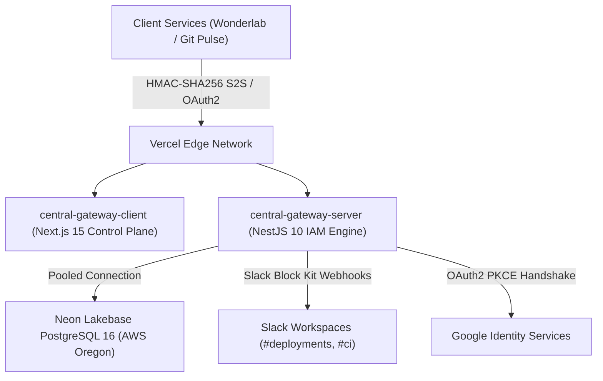

<div align="center">

# Central Gateway

**Centralized Single Sign-On (SSO), IAM Master, and real-time notification hub for distributed applications — part of the Prism Hub ecosystem.**

[](https://github.com/thanhba0505/central-gateway/actions/workflows/ci.yml)
[](https://github.com/thanhba0505/central-gateway/releases)
[](https://github.com/thanhba0505/central-gateway/releases)
[](https://central-gateway-client.vercel.app)
[](https://central-gateway-server.vercel.app/api/v1)
[](https://central-gateway-server.vercel.app/api/docs)
[](LICENSE)

[🌐 Control Plane](https://central-gateway-client.vercel.app) • [📑 Swagger OpenAPI](https://central-gateway-server.vercel.app/api/docs) • [📖 Architecture Guide](docs/architecture.md) • [🚀 Deployment Guide](docs/deployment.md) • [📋 Contributing Guide](CONTRIBUTING.md)

</div>

---

## 📌 Project Overview

**Central Gateway** is the centralized Identity and Access Management (IAM) authority and communications broker for the Prism Hub ecosystem. It decouples client applications, microservices, and CI/CD pipelines from vendor-specific notification SDKs, authentication credentials, and webhook topologies while providing cryptographic Single Sign-On.

### Core Capabilities:

- **Ecosystem IAM & OAuth2 SSO**: Issues and validates centralized user credentials with OAuth2 Authorization Code flow and PKCE (`S256`).
- **Service-to-Service (S2S) Cryptographic Vault**: Authenticates inter-service communications using timing-safe HMAC-SHA256 request signatures with replay prevention windows.
- **Intelligent Multi-Project Routing**: Dispatches CI/CD, deployment, and operational alerts to designated Slack channels based on project slug and event scope.
- **Interactive Control Plane**: Real-time web dashboard providing delivery success rates, searchable audit trail logs, and interactive dispatch sandboxes.
- **Unified Design System**: Consistent, high-clarity notification cards formatted with Slack Block Kit and styled with a cosmic frosted glass aesthetic.

---

## 🌌 Prism Hub Ecosystem

Central Gateway operates as the identity and communication backbone within the **Prism Hub** engineering ecosystem:

| Application         | Role & Mission                                        | Standard Local Port | Live Production                                            | Interactive Docs                                                      |
| :------------------ | :---------------------------------------------------- | :-----------------: | :--------------------------------------------------------- | :-------------------------------------------------------------------- |
| **Central Gateway** | Centralized IAM Master, OAuth2 SSO & Notification Hub |   `5100` / `5101`   | [Control Plane](https://central-gateway-client.vercel.app) | [Swagger OpenAPI](https://central-gateway-server.vercel.app/api/docs) |
| **Wonderlab**       | Interactive Science, Probability & Paradox Laboratory |   `4100` / `4101`   | [Live Experience](https://wonderlab.io.vn)                 | [Swagger OpenAPI](https://wonderlab-server.vercel.app/api/docs)       |
| **Git Pulse**       | Developer Intelligence, Dual-Core AI & Activity Radar |   `6100` / `6101`   | [Developer Workspace](https://git-pulse-app.vercel.app)    | [Swagger OpenAPI](https://git-pulse-server.vercel.app/api/docs)       |

> All services share PostgreSQL 16 on local port `5432` during development and connect to serverless Neon Lakebase PostgreSQL in production.

---

## 🏗️ System Architecture



---

## 📦 Monorepo Structure

```text
central-gateway/
├── client/          # Next.js 15 App Router, React 19, Tailwind CSS v4, Lucide React
├── server/          # NestJS 10 REST API, Prisma ORM, Slack API, Neon PostgreSQL
├── docs/            # Technical specifications, architecture, and integration guides
├── .github/         # Parallel CI/CD workflows, release automation, PR & issue templates
├── .agents/skills/  # Coding guidelines, IAM specifications, and design standards
└── scripts/         # Automated release version synchronization and verification scripts
```

| Workspace    | Technology Stack                              | Local Port | Role & Responsibility                                                              |
| :----------- | :-------------------------------------------- | :--------: | :--------------------------------------------------------------------------------- |
| **`client`** | Next.js 15 App Router, React 19, Tailwind CSS |   `5100`   | Management control plane, delivery analytics, audit trails, and simulator.         |
| **`server`** | NestJS 10, Prisma ORM, Slack SDK              |   `5101`   | REST API (`/api/v1`), OAuth2 SSO provider, Bearer token guard, and Slack dispatch. |

---

## 🚀 Getting Started

### Prerequisites

- **Node.js**: `v24.x` (enforced via `.nvmrc`)
- **Package Manager**: `pnpm` `12.11.2` (`npm i -g pnpm@12.11.2`)
- **Docker**: For local PostgreSQL 16 container (`127.0.0.1:5432`)

### 1. Clone & Install Dependencies

```bash
git clone https://github.com/thanhba0505/central-gateway.git
cd central-gateway
cp .env.example .env.local
pnpm install
```

### 2. Start Local PostgreSQL Database

```bash
docker compose up -d postgres
```

_(PostgreSQL securely binds to loopback `127.0.0.1:5432` with database `central_gateway`)_

### 3. Run Development Servers

```bash
# Start both Client and Server concurrently:
pnpm dev

# Or run services individually:
pnpm dev:client   # Next.js Client on port 5100
pnpm dev:server   # NestJS Server on port 5101
```

### 4. Verification & Testing

```bash
pnpm check          # Full pipeline: Format -> Lint -> Typecheck -> Unit Tests -> Build
pnpm test           # Run Jest test suites
pnpm lint           # ESLint validation with 0 warnings policy
pnpm format:check   # Prettier code formatting check
```

---

## 📑 Technical Documentation Index

Explore in-depth technical guides in `docs/`:

- [System Architecture](docs/architecture.md)
- [Deployment & Vercel Serverless Operations](docs/deployment.md)
- [API Reference & S2S Contracts](docs/api-reference.md)
- [Slack Integration & Block Kit Guide](docs/slack-integration.md)

---

## 📄 License

Licensed under the [MIT License](LICENSE) © 2026 **Bá Lê Thanh** (thanhba0505).
