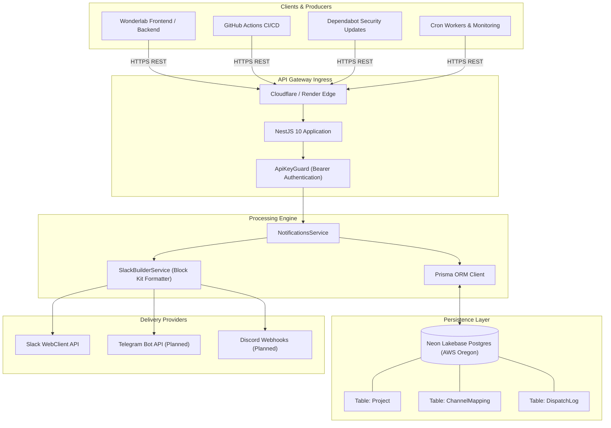

# System Architecture & Technical Specifications

## 1. High-Level Topology

Central Gateway serves as the centralized communications broker across the ThanhBa engineering ecosystem.



---

## 2. Database Schema (Prisma)

The persistence layer runs on Neon Lakebase PostgreSQL.

```prisma
model Project {
  id          String           @id @default(uuid())
  slug        String           @unique
  name        String
  description String?
  isActive    Boolean          @default(true)
  createdAt   DateTime         @default(now())
  updatedAt   DateTime         @updatedAt
  channels    ChannelMapping[]
  logs        DispatchLog[]

  @@map("projects")
}

model ChannelMapping {
  id          String   @id @default(uuid())
  projectId   String
  eventType   String
  channelId   String
  channelName String?
  provider    String   @default("slack")
  createdAt   DateTime @default(now())
  updatedAt   DateTime @updatedAt
  project     Project  @relation(fields: [projectId], references: [id], onDelete: Cascade)

  @@unique([projectId, eventType, provider])
  @@map("channel_mappings")
}

model DispatchLog {
  id         String   @id @default(uuid())
  projectId  String?
  provider   String   @default("slack")
  eventType  String
  status     String
  payload    Json
  response   Json?
  error      String?
  durationMs Int?
  createdAt  DateTime @default(now())
  project    Project? @relation(fields: [projectId], references: [id], onDelete: SetNull)

  @@index([projectId, eventType])
  @@index([createdAt])
  @@map("dispatch_logs")
}
```

---

## 3. Security Boundary & Threat Model

1. **Authentication**:
   - Upstream services must provide the `Authorization: Bearer <GATEWAY_SECRET_KEY>` header.
   - Guarded by NestJS `ApiKeyGuard`. Unauthorized requests immediately return `401 Unauthorized`.

2. **Zero Secret Leakage**:
   - `SLACK_BOT_TOKEN`, `DATABASE_URL`, and internal Render Service IDs are strictly isolated to Central Gateway environment variables.
   - Client projects like Wonderlab contain zero direct Slack credentials.

3. **CORS Restrictions**:
   - Configured via `CORS_ORIGINS` in `server/src/main.ts` with explicit domain whitelisting (`localhost:5000`, `localhost:5100`, `https://central-gateway-client.onrender.com`).
