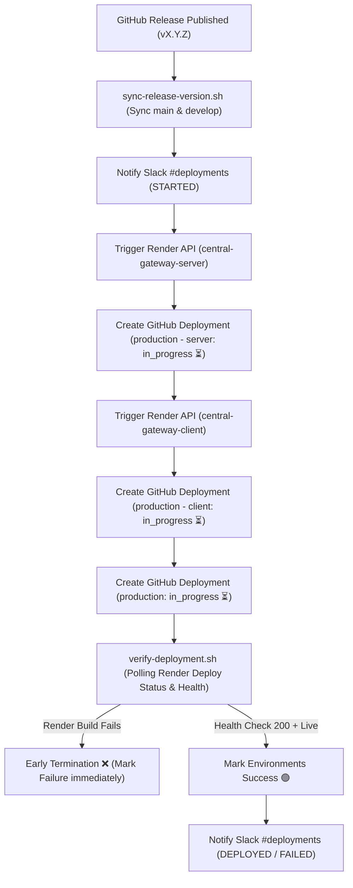

# Deployment Architecture & Operations Guide

Production deployments in **Central Gateway** are fully automated, monitored, and orchestrated across GitHub Actions, Render REST API, and Slack notifications.

---

## 1. High-Level Rollout Architecture

Production deployment is triggered exclusively by publishing a GitHub Release (`v*.*.*`) or pushing a matching tag.

---

## 2. Multi-Tier GitHub Deployments

Rather than a single opaque status, Central Gateway tracks deployments granularly in GitHub's environment interface:

1. **`production - server`**:
   - Initialized as `in_progress` with an active loading spinner ⏳ as soon as the Render Deploy API is invoked.
   - Points to `https://central-gateway-server.onrender.com/api/v1/health`.
   - Transitions to `success` 🟢 once backend health verifies database connectivity.

2. **`production - client`**:
   - Initialized as `in_progress` ⏳ concurrently with the frontend build.
   - Points to `https://central-gateway-client.onrender.com`.
   - Transitions to `success` 🟢 once the Next.js control plane responds with HTTP 200.

3. **`production`**:
   - High-level environment pill representing overall system readiness.
   - Marked `success` 🟢 only when all target services are verified healthy.

---

## 3. Render REST API Integration

Deployments bypass legacy webhooks in favor of authenticated Render REST API calls:

- **Endpoint**: `POST https://api.render.com/v1/services/{service_id}/deploys`
- **Authentication**: `Authorization: Bearer ${{ secrets.RENDER_API_KEY }}`
- **Benefits**:
  - Immediate return of `deploy_id` for fine-grained status tracking.
  - Ability to monitor build status (`build_in_progress`, `live`, `build_failed`, `canceled`).

---

## 4. Fail-Fast Verification (`scripts/verify-deployment.sh`)

Traditional deployment scripts rely solely on HTTP endpoint polling. When a build fails on Render, the previous container remains live, causing health probes to return `200` for stale code until a lengthy timeout expires.

Our verification engine monitors Render's internal deployment lifecycle:

- Queries `GET https://api.render.com/v1/services/{id}/deploys/{deploy_id}` every 10 seconds.
- Detects terminal states immediately: `build_failed`, `pre_deploy_failed`, `canceled`, or `deactivated`.
- Automatically marks the respective GitHub Deployment as `failure` ❌ within 15–30 seconds.
- Polls live health endpoints to verify that the deployed version matches the target release tag.

---

## 5. Automated Slack Notifications

All deployment transitions route through Central Gateway's own notification engine to `#deployments`:

- **Started**: Dispatched immediately upon workflow initiation with release version, target commit hash, and workflow run link.
- **Finished (Success/Failure)**: Summarizes rollout duration, individual service status, and direct health URLs.
