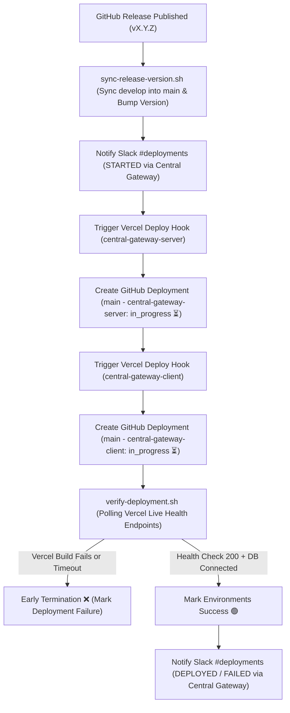

# Deployment Architecture & Operations Guide

Production deployments in **Central Gateway** are fully automated, monitored, and orchestrated across GitHub Actions, Vercel Serverless Deploy Hooks, Neon Lakebase PostgreSQL, and Slack notifications.

---

## 1. High-Level Rollout Architecture

Production deployment is triggered exclusively by publishing an official GitHub Release (`v*.*.*`) or pushing a matching tag.



---

## 2. Infrastructure Specifications

### 1. `central-gateway-client` (Frontend)

- **Platform**: Vercel (`central-gateway-client`)
- **Framework**: Next.js 15 (App Router), React 19
- **Production URL**: [central-gateway-client.vercel.app](https://central-gateway-client.vercel.app)
- **Health Check**: `/health`

### 2. `central-gateway-server` (Backend)

- **Platform**: Vercel Serverless Functions (`central-gateway-server`)
- **Framework**: NestJS 10, Prisma ORM
- **Production URL**: [central-gateway-server.vercel.app/api/v1](https://central-gateway-server.vercel.app/api/v1)
- **Swagger Docs**: [central-gateway-server.vercel.app/api/docs](https://central-gateway-server.vercel.app/api/docs)
- **Health Check**: `/api/v1/health`

### 3. Database Layer

- **Provider**: Neon Lakebase PostgreSQL 16 (AWS Oregon `us-west-2`)
- **Connection Strategy**: PgBouncer connection pooling via `DATABASE_URL` for serverless scaling.
- **Migration Protocol**: Schema migrations run automatically during CI/CD release builds (`prisma migrate deploy`). Manual or ad-hoc migrations from local agent turns are strictly forbidden.

---

## 3. Real-Time Deployment Verification

The deployment pipeline executes `scripts/verify-deployment.sh` to poll live health probes and synchronize GitHub Deployments:

```bash
./scripts/verify-deployment.sh \
  --service all \
  --version "0.4.1" \
  --commit "$RELEASE_COMMIT" \
  --gh-repo "thanhba0505/central-gateway" \
  --timeout 600 \
  --interval 10
```

1. **Initialization**: Immediately registers GitHub Deployments for `main - central-gateway-server` and `main - central-gateway-client` with `state: in_progress` ⏳.
2. **Health Verification**: Periodically probes `/api/v1/health` and `/health` until HTTP 200 and version matching are confirmed.
3. **Success Transition**: Transitions environment status to `success` 🟢 upon verified rollout.
4. **Failure Safeguard**: On timeout or build error, marks environment status `failure` ❌ and dispatches an alert to Slack `#deployments`.
